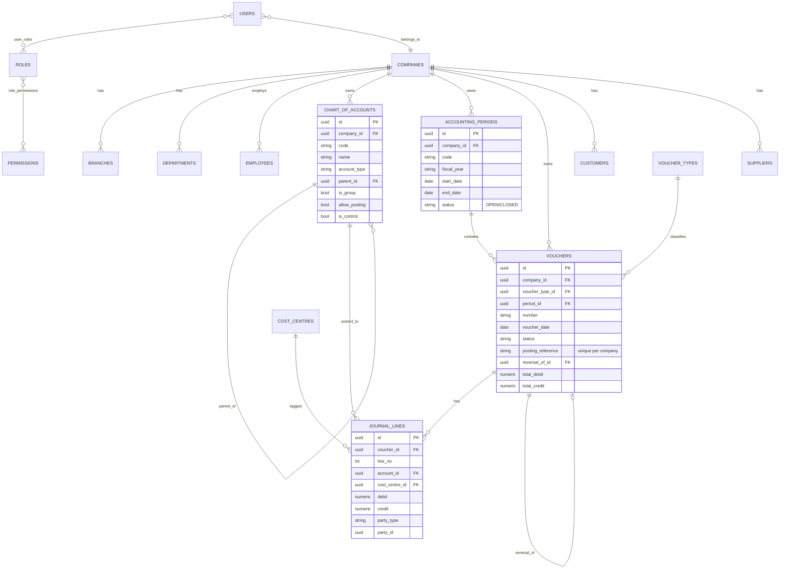
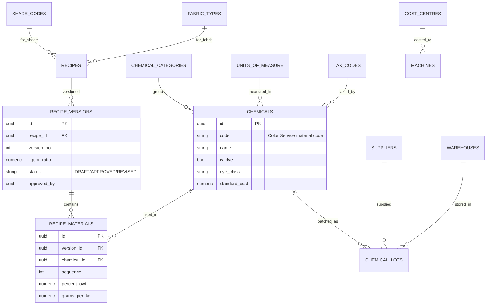
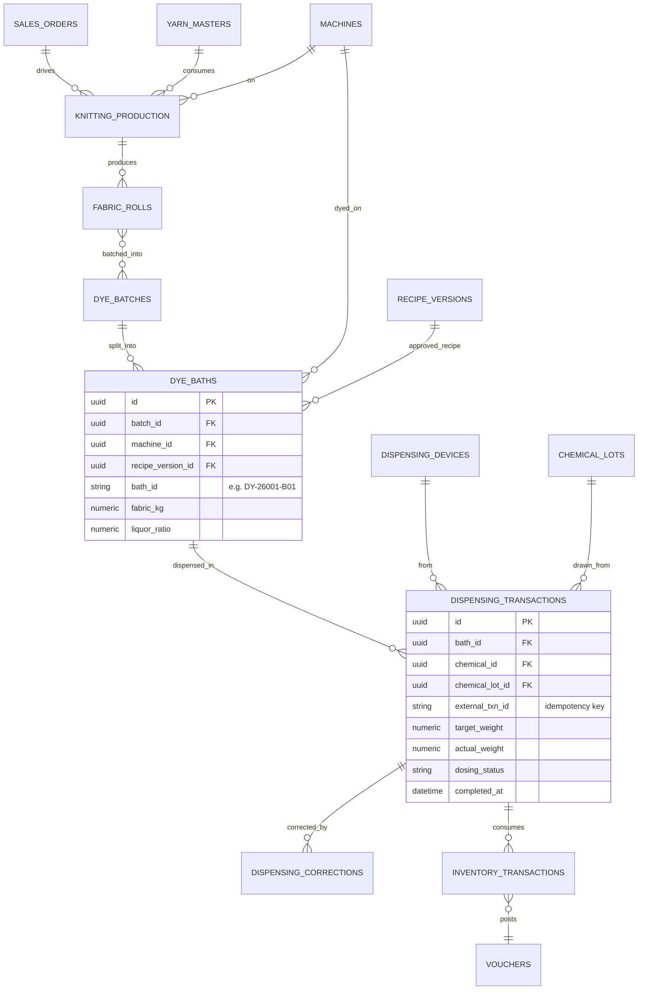
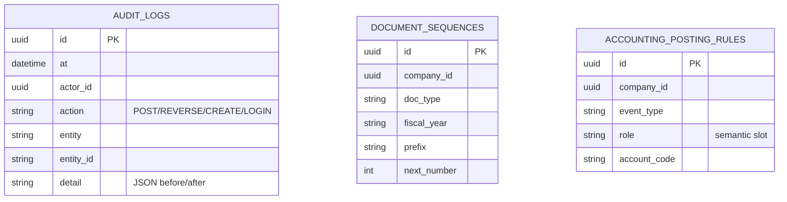

# Database ER Diagram

> Entities marked _(planned)_ are specified here for the full design and are
> created in later stages. All **implemented** tables exist in the ORM
> (`backend/app/models`) and the baseline migration.

## 1. The master traceability chain (brief §18)

Every physical and financial fact must be traceable end to end:

```
Sales Order
   └─▶ Yarn Issue ─▶ Knitting Production ─▶ Greige Rolls
          └─▶ Dye Batch ─▶ Dye Bath ─▶ Approved Recipe (version)
                 └─▶ Color Service Dispensing Transactions ─▶ Chemical Lot
                        └─▶ Chemical Inventory Consumption
                               └─▶ Manufacturing WIP ─▶ Finished Goods
                                      └─▶ Sales Invoice ─▶ General Ledger
```

Each arrow is a foreign key (or a posting reference, for the GL hop). A finished
roll can therefore be walked back to its order, yarn lot, machine, batch, bath,
chemical lot and the exact vouchers that costed it (acceptance TEST 20).

## 2. Implemented schema (Stage 1)



### Master data (implemented)



## 3. Planned transactional schema (Stages 2–5)

These tables complete the traceability chain. Keys shown are the spine; full
column lists are defined as each stage is built.



## 4. Control & audit (implemented)



## 5. Notes on modelling choices

- **Machines**: knitting/dyeing/finishing are one `machines` table keyed by
  `machine_type`, not three near-identical tables — uniform scheduling,
  downtime and cost-centre linkage. The spec's three logical tables are views
  (filters) over it.
- **Chemicals & dyes** share one `chemicals` master (`is_dye` flag) so recipes,
  lots, dispensing and inventory treat them uniformly.
- **Sub-ledgers**: customer/supplier/inventory sub-ledgers are `journal_lines`
  tagged with `party_type`/`party_id` plus control-account flags on the chart of
  accounts, so the GL and sub-ledgers reconcile by construction.
